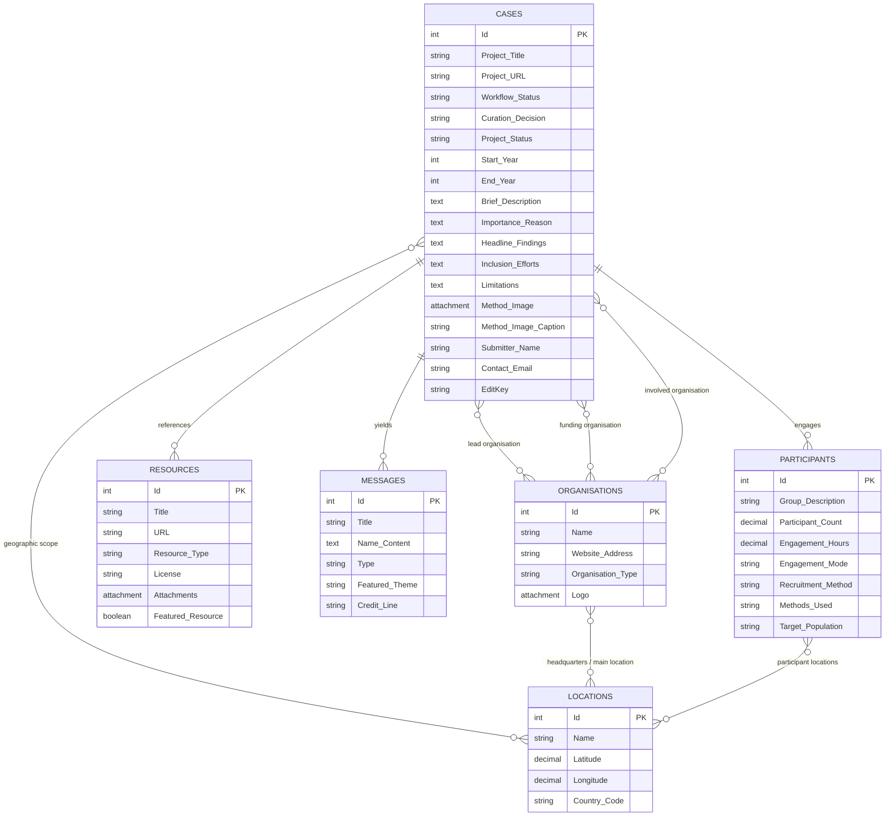

# PAVE Case Book: Data Model Specification

## 1. Overview & Architecture

The **PAVE Case Book** (Public AI Voices & Engagement) is backed by a relational data model hosted in NocoDB (**Base ID**: `p1t9vvz76dbkcv8` in workspace **Citizens' Track on AI** `wvreepvh`).

The model is designed to capture participatory AI initiatives across the globe—from large-scale citizens' assemblies and deliberative polls to grassroots community audits and participatory arts projects. It models projects (cases), the organisations behind them, the participant groups involved, external supporting evidence/resources, key qualitative messages (recommendations, issues, actions, quotes), and geographic locations.

---

## 2. Entity-Relationship Diagram

---

## 3. Core Tables & Field Definitions

### 3.1. `Cases` (`m1e33iafsgoy4re`)
The primary entity representing a single participatory AI initiative or case study.

| Field Name | Type | Key / Notes | Description |
| :--- | :--- | :--- | :--- |
| `Id` | `ID` | Primary Key | Unique autoincrement integer identifier. |
| `Project Title` | `SingleLineText` | Required | Title/name of the public engagement initiative. |
| `Project URL` | `URL` | Required | Web link where official project reports/resources reside. |
| `Describe the subject matter in your own words (one line)` | `SingleLineText` | Optional | One-line summary of what the engagement investigated (e.g. "Public attitudes to facial recognition in policing"). |
| `Provide a brief description of the project` | `LongText` | Rich Text (Markdown) | Multi-paragraph overview of engagement objectives, scope, and process. |
| `Why is this project important to include in the case book?` | `LongText` | Rich Text (Markdown) | Novelty, policy impact, methodological breakthrough, or lesson learned. |
| `Headline findings` | `LongText` | Rich Text (Markdown) | Key takeaways, outputs, or consensus points from the project. |
| `Inclusion efforts` | `LongText` | Rich Text (Markdown) | Targeted outreach, translation, peer researchers, or accommodations. |
| `What limitations to the project should be noted?` | `LongText` | Rich Text (Markdown) | Constraints, disrupted data collection, or underrepresented cohorts. |
| `How was the project initiated?` | `MultiSelect` | Codelist | Commissioned, Academic research, Community Led, Co-created, Other. |
| `Project goals` | `MultiSelect` | Codelist | Policy, Quantitative, Qualitative, Empowerment, Methods, Capacity, AI Dev, Audit, Evaluate. |
| `What form of AI is the project about?` | `MultiSelect` | Codelist | Generative AI, Predictive AI, Specific AI system(s), AI in general, Current issues, Future issues. |
| `What year did the project start?` | `Number` | Integer (1950–2050) | Initiation year of public engagement. |
| `What year did the project conclude?` | `Number` | Integer (1950–2050) | Conclusion year of public engagement (or estimated end year). |
| `Project status` | `SingleSelect` | Codelist | `Planned`, `In Progress`, `Complete`. |
| `Workflow: Status` | `SingleSelect` | Codelist | `Nomination`, `Submission`, `Draft`, `Under Review`, `Completed`, `Rejected`, `Duplicate`. |
| `Curation decision` | `SingleSelect` | Codelist (Staff) | `Featured Full Case`, `Full Case`, `Mapping Entry`, `Do not include`. |
| `Assigned to` | `User` | NocoDB User (Staff) | Assigned PAVE researcher/curator. |
| `Next Action` | `MultiSelect` | Codelist (Staff) | Operational triage actions (e.g. "Invite to submit", "Peer-review"). |
| `Method Image` | `Attachment` | Max 1 file (Staff) | Visual method workflow diagram, process map, or framework graphic. |
| `Method image caption` | `SingleLineText` | String (Staff) | Attribution, source, and descriptive caption for method image. |
| `Photos and images` | `Attachment` | Max 5 files | Photographic documentation from workshops/deliberations. |
| `Photos available?` | `MultiSelect` | Codelist | Submitter declaration on image rights and availability. |
| `Was AI used to assist in summary generation?` | `MultiSelect` | Codelist | Disclosure on generative AI assistance during case authoring. |
| `Which of the following resources are available for this project?` | `MultiSelect` | Codelist | Report, video, evaluation, research poster, method toolkit. |
| `Submitted by` | `SingleLineText` | Submitter metadata | Submitter full name. |
| `Contact e-mail` | `Email` | Submitter metadata | Submitter email address (used for edit links and notifications). |
| `Submitter role` | `MultiSelect` | Codelist | Project leader, Project team, Participant, Observer, Other, Not involved, Commissioner. |
| `Additional acknowledgements` | `SingleLineText` | Optional | Team members, funders, or contributors to acknowledge. |
| `EditKey` | `SingleLineText` | UUID Secret | Cryptographic key allowing submitters to edit their record without login. |
| `Lead organisations` | `LinkToAnotherRecord` | M2M &rarr; `Organisations` | Primary conveners or delivery organisations. |
| `Funding Organisations` | `LinkToAnotherRecord` | M2M &rarr; `Organisations` | Grantmakers, philanthropic funders, or commissioning bodies. |
| `Involved organisations` | `LinkToAnotherRecord` | M2M &rarr; `Organisations` | Facilitation partners, tech providers, or community partners. |
| `Geographic scope` | `LinkToAnotherRecord` | M2M &rarr; `Locations` | Geographic coverage of the case. |
| `Participants` | `LinkToAnotherRecord` | M2M &rarr; `Participants` | Linked participant groups/cohorts. |
| `Supporting resources` | `LinkToAnotherRecord` | M2M &rarr; `Resources` | Attached/linked reports, slide decks, media, and toolkits. |
| `Messages` | `LinkToAnotherRecord` | M2M &rarr; `Messages` | Linked recommendations, issues, actions, and quotes. |

---

### 3.2. `Organisations` (`mecsh2ykfxm0s2f`)
Entities funding, initiating, delivering, or partnering on participatory initiatives.

| Field Name | Type | Notes | Description |
| :--- | :--- | :--- | :--- |
| `Id` | `ID` | Primary Key | Unique autoincrement integer identifier. |
| `Name` | `SingleLineText` | Display Field | Legal or commonly used title of the organisation. |
| `Website address` | `URL` | Optional | Official homepage or portal URL. |
| `Organisation type` | `MultiSelect` | Codelist | `Private sector`, `Funder`, `Public sector`, `Non-profit`, `Research`, `Individual Donor`. |
| `Logo` | `Attachment` | Image file | Organisation visual identity mark. |
| `Main Location` | `LinkToAnotherRecord` | M2M &rarr; `Locations` | Headquarters or primary operational location. |
| `Lead organisation for` | `LinkToAnotherRecord` | Backlink &rarr; `Cases` | Inverse relationship for lead conveners. |
| `Funding organisation for` | `LinkToAnotherRecord` | Backlink &rarr; `Cases` | Inverse relationship for project funders. |
| `Involved organisation for`| `LinkToAnotherRecord` | Backlink &rarr; `Cases` | Inverse relationship for delivery/community partners. |

---

### 3.3. `Locations` (`m585w7nu1pegh83`)
Geocoded geographic points and administrative entities.

| Field Name | Type | Notes | Description |
| :--- | :--- | :--- | :--- |
| `Id` | `ID` | Primary Key | Unique autoincrement integer identifier. |
| `Name` | `SingleLineText` | Display Field | Location label (e.g. "Manchester, United Kingdom", "Global", "Nairobi"). |
| `Latitude` | `Decimal` | Float (WGS84) | Geocoded latitude coordinate. |
| `Longitude` | `Decimal` | Float (WGS84) | Geocoded longitude coordinate. |
| `Country Code` | `SingleLineText` | ISO 3166-1 alpha-2 | 2-letter uppercase country code (e.g. `GB`, `KE`, `US`, `FR`). |
| `Cases` | `LinkToAnotherRecord` | Backlink &rarr; `Cases` | Cases covering this geographic scope. |
| `Organisations` | `LinkToAnotherRecord` | Backlink &rarr; `Organisations` | Organisations headquartered at this location. |
| `Participants` | `LinkToAnotherRecord` | Backlink &rarr; `Participants` | Participant groups residing or meeting in this location. |

---

### 3.4. `Participants` (`mtys2m273atfyd9`)
Quantified cohorts and demographics involved in engagement processes.

| Field Name | Type | Notes | Description |
| :--- | :--- | :--- | :--- |
| `Id` | `ID` | Primary Key | Unique autoincrement integer identifier. |
| `Title` | `Formula` | Display Field | Derived title formula: `({Cases} + " - ") + {Group description}`. |
| `Group description` | `SingleLineText` | Required | Label for this cohort (e.g. "National Deliberative Sample", "Youth Advisory Panel"). |
| `How many people took part?` | `Decimal` | Number (integer) | Quantitative headcount of participants. |
| `On average, how many hours did each participant engage for?` | `Decimal` | Number (hours) | Engagement depth (e.g., `0.25` for survey, `40.0` for citizens' assembly). |
| `Where did engagement take place?` | `MultiSelect` | Codelist | `Online`, `Offline`, `Hybrid`. |
| `Recruitment method` | `SingleSelect` | Codelist | `Demographic lottery`, `Self selected / volunteered`, `Peer recruitment (snowball)`, `Statistical sample`, `Other`. |
| `Recruitment description` | `SingleLineText` | Narrative | Brief explanation of sampling/recruitment mechanisms. |
| `Was there a specific target population?` | `SingleLineText` | Narrative | Sub-population focus (e.g. "Primary school teachers", "Gig economy workers"). |
| `Which of the following methods were used to engage participants?` | `MultiSelect` | Codelist | Specific deliberation or participation methodologies (29 codelist choices). |
| `Do any of the following apply?` | `MultiSelect` | Flags | `There was a learning phase for participants`, `There were trained facilitators involved`, `Materials from the learning phase have been published`. |
| `Additional notes` | `LongText` | Narrative | Additional demographic context or process observations. |
| `Locations` | `LinkToAnotherRecord` | M2M &rarr; `Locations` | Country/city locations where participants were based. |
| `Cases` | `LinkToAnotherRecord` | Backlink &rarr; `Cases` | Parent case. |

---

### 3.5. `Resources` (`mm1j25f6w0s1hsn`)
Evidence, outputs, and documentation associated with a case.

| Field Name | Type | Notes | Description |
| :--- | :--- | :--- | :--- |
| `Id` | `ID` | Primary Key | Unique autoincrement integer identifier. |
| `Title` | `SingleLineText` | Required | Title of the publication, slide deck, recording, or dataset. |
| `URL` | `URL` | Optional | External web link to hosted resource. |
| `Select` (Resource Type) | `SingleSelect` | Codelist | `Project report`, `Facilitation guide`, `Workshop resource`, `Media coverage`, `Photo or image`, `Citation`, `Research poster`, `Evaluation`, `Video`, `Academic paper or presentation`, `Other`. |
| `Attachments` | `Attachment` | File(s) | Uploaded PDF documents, slides, or graphics. |
| `License` | `SingleLineText` | Optional | Copyright / open license terms (e.g. `CC-BY-4.0`, `Open Government Licence`). |
| `Short description` | `SingleLineText` | Optional | Contextual summary of the resource. |
| `Featured Video / Resource`| `Checkbox` | Boolean | Highlighted flag for embedding in the case study header. |
| `Video notes` | `SingleLineText` | Optional | Host metadata (e.g. YouTube / Vimeo video ID). |
| `StartAt` | `SingleLineText` | Optional | Video timestamp offset (e.g. `01:45`). |
| `Cases` | `LinkToAnotherRecord` | Backlink &rarr; `Cases` | Parent case. |

---

### 3.6. `Messages` (`mujfx489gv4v1co`)
Actionable outcomes, civic recommendations, and qualitative findings distilled from public voice.

| Field Name | Type | Notes | Description |
| :--- | :--- | :--- | :--- |
| `Id` | `ID` | Primary Key | Unique autoincrement integer identifier. |
| `Title` | `SingleLineText` | Display Field | Message header (e.g. "Recommendation 1", "Public Concern on Data Sharing"). |
| `Name` (Message Content) | `LongText` | Required | Full text of the recommendation, quote, or finding. |
| `Type` | `SingleSelect` | Codelist | `Recommendation`, `Issue`, `Quote`, `Action`. |
| `Featured (Theme)` | `MultiSelect` | Codelist | Cross-case thematic indexing: `Global`, `AI Literacy`, `Work`, `Participation`, `AI for Good`, `Governance`, `Social Media`, `Safety`, `Education`, `AI development`. |
| `Additional Credit Line` | `SingleLineText` | Optional | Specific group, individual, or session attribution. |
| `Cases` | `LinkToAnotherRecord` | Backlink &rarr; `Cases` | Parent case. |

---

## 4. Controlled Vocabularies & Codelists

### Workflow Status (`Cases.Workflow: Status`)
1. **Nomination**: Initial submission containing basic title, URL, and contact details awaiting triage.
2. **Submission**: Full submission received with narratives and initial metadata.
3. **Draft**: Record under active editing or expansion by PAVE research staff.
4. **Under Review**: Case entry completed and undergoing peer/editorial review.
5. **Completed**: Approved, validated, and ready for publication in the public Case Book.
6. **Rejected**: Entry out of scope, spam, or withdrawn.
7. **Duplicate**: Redundant entry merged into another case study.

### Curation Decision (`Cases.Curation decision`)
1. **Featured Full Case**: Deep-dive case study with comprehensive participant data, method diagram, resources, and messages; featured on main portal landing pages.
2. **Full Case**: Complete case book entry with structured data across all stages.
3. **Mapping Entry**: Lighter-touch record included in map visualizations, indexing, and synthesis statistics.
4. **Do not include**: Internal reference or withheld from public index.

### Engagement Methodologies (`Participants.Which of the following methods...`)
- *Deliberative*: Citizens’ Assembly, Citizens' Jury, Deliberation, Deliberative Polling®, Public Dialogue, Distributed dialogue.
- *Collaborative & Participatory*: Co-creation workshops, Prototyping, Collective Intelligence Process, Participatory futures workshop, Future Workshop, Scenario Workshop, Forum Theatre, Participatory Arts.
- *Research & Consultative*: Action Research, Community Advisory Group, Community-Based Participatory Research, Community-led Audit, Peer-Research, Focus Group, Interviews, Roundtable Discussion, Survey, Opinion Polling, Crowdsourcing, Public Hearing, Notice and Request for Public Comment, Capacity Building Workshop, Workers' Council.

---

## 5. Security & Access Model

1. **Public Submissions & Nominations**:
   - Anyone can submit a case via the public intake form.
   - Upon creation, a random UUID (`EditKey`) is generated and stored with the record. The submitter receives an edit link containing `?id=N&editKey=UUID`.
   - Edits using a valid `EditKey` are restricted: submitters can update project narratives and linked data, but **cannot** alter `Workflow: Status`, `Curation decision`, or `Assigned to`.
2. **Staff Editing Mode**:
   - Requires an authenticated NocoDB personal API token (`xc-token`).
   - Grants permission to edit any case regardless of workflow status, assign curators, alter curation decisions, add method diagrams, inspect revision history, and post record comments.
   - All server-side requests to NocoDB execute via the Cloudflare Worker proxy using strict schema sanitization and field length limits.

